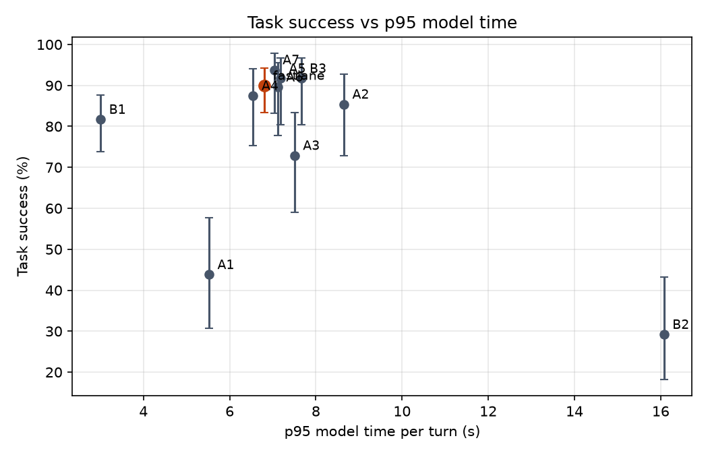

# Results: run `final`

| System | Calls | Success (95% CI) | p50 model ms | p95 model ms | p95 vs B1 | Large-model turns | Router precision / hard recall | Hard recall, dates in code | Unsafe-write calls | Missed hand-offs |
|---|---|---|---|---|---|---|---|---|---|---|
| fastlane | 120 | 90.0% (83-94%) | 1,672 | 6,808 | -126.5% | 20.9% | 57.6% / 73.4% | 83.2% | 0.0% | 0/15 |
| B1 | 120 | 81.7% (74-88%) | 1,036 | 3,006 | 0.0% | 100.0% | - | - | 36.7% | 0/15 |
| B2 | 48 | 29.2% (18-43%) | 1,653 | 16,076 | -434.8% | 0.0% | - | - | 0.0% | 1/6 |
| B3 | 48 | 91.7% (80-97%) | 1,657 | 7,658 | -154.8% | 76.0% | 42.0% / 81.0% | 88.6% | 0.0% | 0/6 |
| A1 | 48 | 43.8% (31-58%) | 1,528 | 5,521 | -83.7% | 12.8% | 34.4% / 60.0% | 67.7% | 0.0% | 0/6 |
| A2 | 48 | 85.4% (73-93%) | 2,611 | 8,650 | -187.8% | 41.8% | 34.5% / 90.5% | - | 0.0% | 0/6 |
| A3 | 48 | 72.9% (59-83%) | 2,279 | 7,504 | -149.7% | 27.8% | 39.3% / 64.9% | 68.8% | 64.6% | 0/6 |
| A4 | 48 | 87.5% (75-94%) | 1,756 | 6,545 | -117.7% | 30.2% | 38.6% / 77.3% | 86.8% | 0.0% | 0/6 |
| A5 | 48 | 91.7% (80-97%) | 1,700 | 7,180 | -138.9% | 21.1% | 61.5% / 80.0% | 88.6% | 0.0% | 0/6 |
| A6 | 48 | 89.6% (78-96%) | 1,676 | 7,114 | -136.7% | 19.7% | 57.7% / 68.2% | 76.3% | 0.0% | 0/6 |
| A7 | 48 | 93.8% (83-98%) | 1,810 | 7,034 | -134.0% | 24.7% | 51.5% / 75.6% | 89.5% | 0.0% | 0/6 |

## fastlane

Fine-tuned small model answers easy turns and passes hard ones to the large model or staff.

- Success by category: {'change_mind': '10/15', 'dates': '15/15', 'policy': '11/15', 'red_flag': '15/15', 'returning': '14/15', 'rule_break': '15/15', 'simple': '14/15', 'sold_out': '14/15'}
- Success by domain: {'buses': '37/40', 'movies': '35/40', 'restaurants': '36/40'}
- Tokens per call (prompt, completion) by role: {'small': [3845, 296], 'large': [3755, 405]}
- Large-model calls per call: 1.76; rate-limit wait per call: 0.0 s
- Large-model calls answered by: {'groq:openai/gpt-oss-120b': 211}
- Unconfirmed writes: 0; rule-violating writes: 0
- Invalid tool-call rate: 0.012; success on calls with injected errors: 0.875
- Policy answer accuracy: 0.8; early lookup: {'started': 21, 'reused': 11, 'wasted': 4, 'cache_hits': 5, 'saved_ms_total': 5.6}
- Lookup-turn p95: 6528.4 ms; errors: 0
- Escalation reasons: {'tool error': 38, 'no availability': 32, 'small model': 21, 'staff': 12, 'small model gave no reply': 11, 'unconfident policy match': 7, 'policy answer with numbers': 6, 'caller changed time': 5}

## B1

Large model only; rules in the prompt.

- Success by category: {'change_mind': '8/15', 'dates': '11/15', 'policy': '13/15', 'red_flag': '15/15', 'returning': '15/15', 'rule_break': '14/15', 'simple': '14/15', 'sold_out': '8/15'}
- Success by domain: {'buses': '30/40', 'movies': '33/40', 'restaurants': '35/40'}
- Tokens per call (prompt, completion) by role: {'large': [18197, 1351]}
- Large-model calls per call: 8.02; rate-limit wait per call: 0.0 s
- Large-model calls answered by: {'groq:openai/gpt-oss-120b': 962}
- Unconfirmed writes: 53; rule-violating writes: 3
- Invalid tool-call rate: 0.006; success on calls with injected errors: 0.875
- Policy answer accuracy: 0.867; early lookup: {'started': 26, 'reused': 10, 'wasted': 10, 'cache_hits': 1, 'saved_ms_total': 6.4}
- Lookup-turn p95: 2277.1 ms; errors: 0

## B2

Small model only, no fine-tuning; large model never used.

- Success by category: {'change_mind': '0/6', 'dates': '1/6', 'policy': '0/6', 'red_flag': '5/6', 'returning': '1/6', 'rule_break': '6/6', 'simple': '1/6', 'sold_out': '0/6'}
- Success by domain: {'buses': '3/16', 'movies': '6/16', 'restaurants': '5/16'}
- Tokens per call (prompt, completion) by role: {'small': [29327, 1313]}
- Large-model calls per call: 0.0; rate-limit wait per call: 0.0 s
- Large-model calls answered by: {}
- Unconfirmed writes: 0; rule-violating writes: 0
- Invalid tool-call rate: 0.276; success on calls with injected errors: 0.25
- Policy answer accuracy: 0.333; early lookup: {'started': 63, 'reused': 13, 'wasted': 22, 'cache_hits': 0, 'saved_ms_total': 10.6}
- Lookup-turn p95: 11606.6 ms; errors: 0

## B3

Large model prompted to route each turn easy/hard before it is answered.

- Success by category: {'change_mind': '6/6', 'dates': '6/6', 'policy': '4/6', 'red_flag': '6/6', 'returning': '6/6', 'rule_break': '6/6', 'simple': '5/6', 'sold_out': '5/6'}
- Success by domain: {'buses': '14/16', 'movies': '15/16', 'restaurants': '15/16'}
- Tokens per call (prompt, completion) by role: {'router': [1108, 127], 'small': [3184, 258], 'large': [5588, 584]}
- Large-model calls per call: 6.94; rate-limit wait per call: 0.0 s
- Large-model calls answered by: {'groq:openai/gpt-oss-120b': 333}
- Unconfirmed writes: 0; rule-violating writes: 0
- Invalid tool-call rate: 0.008; success on calls with injected errors: 0.75
- Policy answer accuracy: 1.0; early lookup: {'started': 21, 'reused': 10, 'wasted': 4, 'cache_hits': 2, 'saved_ms_total': 7.6}
- Lookup-turn p95: 5241.9 ms; errors: 0
- Escalation reasons: {'large-model router': 58, 'tool error': 13, 'no availability': 8, 'caller changed seat_category': 1, 'caller changed time': 1}

## A1

No fine-tuning; small model prompted.

- Success by category: {'change_mind': '1/6', 'dates': '0/6', 'policy': '4/6', 'red_flag': '6/6', 'returning': '1/6', 'rule_break': '6/6', 'simple': '1/6', 'sold_out': '2/6'}
- Success by domain: {'buses': '9/16', 'movies': '7/16', 'restaurants': '5/16'}
- Tokens per call (prompt, completion) by role: {'small': [13580, 510], 'large': [4317, 378]}
- Large-model calls per call: 1.88; rate-limit wait per call: 0.0 s
- Large-model calls answered by: {'groq:openai/gpt-oss-120b': 90}
- Unconfirmed writes: 0; rule-violating writes: 0
- Invalid tool-call rate: 0.17; success on calls with injected errors: 0.0
- Policy answer accuracy: 0.667; early lookup: {'started': 9, 'reused': 5, 'wasted': 2, 'cache_hits': 0, 'saved_ms_total': 3.2}
- Lookup-turn p95: 3593.7 ms; errors: 0
- Escalation reasons: {'tool error': 32, 'small model': 13, 'no availability': 6, 'staff': 5, 'policy answer with numbers': 3, 'unparseable small output': 1, 'small model repeated a tool call': 1}

## A2

No date and alternative tools.

- Success by category: {'change_mind': '3/6', 'dates': '5/6', 'policy': '5/6', 'red_flag': '6/6', 'returning': '6/6', 'rule_break': '6/6', 'simple': '5/6', 'sold_out': '5/6'}
- Success by domain: {'buses': '14/16', 'movies': '12/16', 'restaurants': '15/16'}
- Tokens per call (prompt, completion) by role: {'small': [3960, 333], 'large': [5947, 722]}
- Large-model calls per call: 3.35; rate-limit wait per call: 0.0 s
- Large-model calls answered by: {'groq:openai/gpt-oss-120b': 161}
- Unconfirmed writes: 0; rule-violating writes: 0
- Invalid tool-call rate: 0.031; success on calls with injected errors: 0.75
- Policy answer accuracy: 1.0; early lookup: {'started': 14, 'reused': 5, 'wasted': 4, 'cache_hits': 2, 'saved_ms_total': 2.1}
- Lookup-turn p95: 8084.5 ms; errors: 0
- Escalation reasons: {'tool error': 38, 'small model': 36, 'small model gave no reply': 10, 'no availability': 7, 'staff': 6, 'policy answer with numbers': 5, 'caller changed time': 5, 'unconfident policy match': 2}

## A3

No safety checks; rules only in the prompt, no read-back.

- Success by category: {'change_mind': '2/6', 'dates': '4/6', 'policy': '5/6', 'red_flag': '6/6', 'returning': '6/6', 'rule_break': '1/6', 'simple': '5/6', 'sold_out': '6/6'}
- Success by domain: {'buses': '11/16', 'movies': '11/16', 'restaurants': '13/16'}
- Tokens per call (prompt, completion) by role: {'small': [3880, 286], 'large': [5020, 415]}
- Large-model calls per call: 2.21; rate-limit wait per call: 0.0 s
- Large-model calls answered by: {'groq:openai/gpt-oss-120b': 106}
- Unconfirmed writes: 40; rule-violating writes: 9
- Invalid tool-call rate: 0.064; success on calls with injected errors: 0.75
- Policy answer accuracy: 1.0; early lookup: {'started': 14, 'reused': 8, 'wasted': 3, 'cache_hits': 3, 'saved_ms_total': 4.8}
- Lookup-turn p95: 6392.1 ms; errors: 0
- Escalation reasons: {'tool error': 19, 'small model gave no reply': 17, 'no availability': 7, 'small model': 6, 'policy answer with numbers': 4, 'staff': 4, 'caller changed quantity': 1, 'caller changed seat_category': 1}

## A4

No booking record; models see chat history only.

- Success by category: {'change_mind': '4/6', 'dates': '5/6', 'policy': '4/6', 'red_flag': '6/6', 'returning': '6/6', 'rule_break': '6/6', 'simple': '6/6', 'sold_out': '5/6'}
- Success by domain: {'buses': '16/16', 'movies': '12/16', 'restaurants': '14/16'}
- Tokens per call (prompt, completion) by role: {'small': [4463, 365], 'large': [5773, 460]}
- Large-model calls per call: 2.77; rate-limit wait per call: 0.0 s
- Large-model calls answered by: {'groq:openai/gpt-oss-120b': 133}
- Unconfirmed writes: 0; rule-violating writes: 0
- Invalid tool-call rate: 0.018; success on calls with injected errors: 1.0
- Policy answer accuracy: 1.0; early lookup: {'started': 16, 'reused': 7, 'wasted': 4, 'cache_hits': 3, 'saved_ms_total': 4.2}
- Lookup-turn p95: 6334.6 ms; errors: 0
- Escalation reasons: {'tool error': 37, 'no availability': 13, 'caller changed time': 9, 'small model gave no reply': 7, 'unconfident policy match': 5, 'staff': 4, 'small model': 4, 'policy answer with numbers': 3}

## A5

No step-by-step reasoning on hard turns.

- Success by category: {'change_mind': '5/6', 'dates': '6/6', 'policy': '4/6', 'red_flag': '6/6', 'returning': '6/6', 'rule_break': '6/6', 'simple': '6/6', 'sold_out': '5/6'}
- Success by domain: {'buses': '15/16', 'movies': '14/16', 'restaurants': '15/16'}
- Tokens per call (prompt, completion) by role: {'small': [3501, 269], 'large': [3552, 169]}
- Large-model calls per call: 1.71; rate-limit wait per call: 0.0 s
- Large-model calls answered by: {'groq:openai/gpt-oss-120b': 82}
- Unconfirmed writes: 0; rule-violating writes: 0
- Invalid tool-call rate: 0.013; success on calls with injected errors: 1.0
- Policy answer accuracy: 1.0; early lookup: {'started': 17, 'reused': 7, 'wasted': 4, 'cache_hits': 4, 'saved_ms_total': 4.7}
- Lookup-turn p95: 5922.7 ms; errors: 0
- Escalation reasons: {'tool error': 14, 'small model gave no reply': 11, 'no availability': 9, 'small model': 4, 'policy answer with numbers': 4, 'staff': 4, 'unconfident policy match': 2, 'small model repeated a tool call': 1}

## A6

No early lookup.

- Success by category: {'change_mind': '5/6', 'dates': '6/6', 'policy': '4/6', 'red_flag': '6/6', 'returning': '6/6', 'rule_break': '6/6', 'simple': '5/6', 'sold_out': '5/6'}
- Success by domain: {'buses': '14/16', 'movies': '14/16', 'restaurants': '15/16'}
- Tokens per call (prompt, completion) by role: {'small': [3861, 312], 'large': [3580, 371]}
- Large-model calls per call: 1.69; rate-limit wait per call: 0.0 s
- Large-model calls answered by: {'groq:openai/gpt-oss-120b': 81}
- Unconfirmed writes: 0; rule-violating writes: 0
- Invalid tool-call rate: 0.012; success on calls with injected errors: 0.75
- Policy answer accuracy: 0.833; early lookup: {'started': 0, 'reused': 0, 'wasted': 0, 'cache_hits': 0, 'saved_ms_total': 0.0}
- Lookup-turn p95: 8752.5 ms; errors: 0
- Escalation reasons: {'tool error': 15, 'no availability': 10, 'policy answer with numbers': 6, 'small model gave no reply': 6, 'small model': 4, 'staff': 4, 'caller changed time': 3, 'unconfident policy match': 2}

## A7

No caller history.

- Success by category: {'change_mind': '6/6', 'dates': '6/6', 'policy': '5/6', 'red_flag': '6/6', 'returning': '5/6', 'rule_break': '6/6', 'simple': '5/6', 'sold_out': '6/6'}
- Success by domain: {'buses': '15/16', 'movies': '14/16', 'restaurants': '16/16'}
- Tokens per call (prompt, completion) by role: {'small': [3749, 306], 'large': [4839, 485]}
- Large-model calls per call: 2.33; rate-limit wait per call: 0.0 s
- Large-model calls answered by: {'groq:openai/gpt-oss-120b': 112}
- Unconfirmed writes: 0; rule-violating writes: 0
- Invalid tool-call rate: 0.033; success on calls with injected errors: 0.75
- Policy answer accuracy: 1.0; early lookup: {'started': 16, 'reused': 7, 'wasted': 4, 'cache_hits': 2, 'saved_ms_total': 4.3}
- Lookup-turn p95: 6275.3 ms; errors: 0
- Escalation reasons: {'tool error': 19, 'small model gave no reply': 14, 'small model': 10, 'no availability': 10, 'staff': 5, 'policy answer with numbers': 4, 'caller changed seat_category': 1, 'caller changed time': 1}
