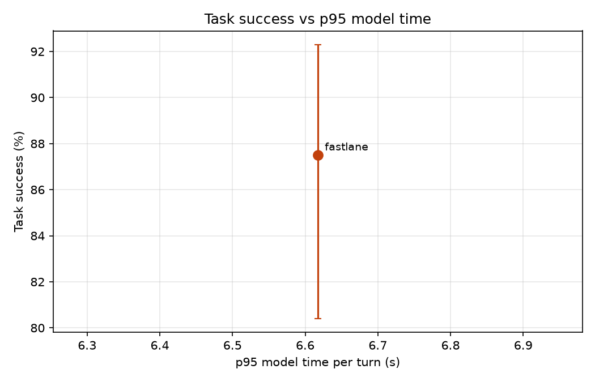

# Results: run `final_fix`

| System | Calls | Success (95% CI) | p50 model ms | p95 model ms | p95 vs B1 | Large-model turns | Router precision / hard recall | Hard recall, dates in code | Unsafe-write calls | Missed hand-offs |
|---|---|---|---|---|---|---|---|---|---|---|
| fastlane | 120 | 87.5% (80-92%) | 1,662 | 6,617 | - | 20.5% | 51.8% / 72.0% | 84.7% | 0.0% | 0/15 |

## fastlane

Fine-tuned small model answers easy turns and passes hard ones to the large model or staff.

- Success by category: {'change_mind': '8/15', 'dates': '15/15', 'policy': '10/15', 'red_flag': '15/15', 'returning': '15/15', 'rule_break': '15/15', 'simple': '14/15', 'sold_out': '13/15'}
- Success by domain: {'buses': '37/40', 'movies': '33/40', 'restaurants': '35/40'}
- Tokens per call (prompt, completion) by role: {'small': [3935, 303], 'large': [3434, 334]}
- Large-model calls per call: 1.64; rate-limit wait per call: 0.0 s
- Large-model calls answered by: {'groq:openai/gpt-oss-120b': 197}
- Unconfirmed writes: 0; rule-violating writes: 0
- Invalid tool-call rate: 0.01; success on calls with injected errors: 0.938
- Policy answer accuracy: 0.8; early lookup: {'started': 23, 'reused': 12, 'wasted': 4, 'cache_hits': 5, 'saved_ms_total': 7.8}
- Lookup-turn p95: 6235.6 ms; errors: 0
- Escalation reasons: {'tool error': 48, 'no availability': 22, 'small model': 17, 'staff': 14, 'small model gave no reply': 11, 'policy answer with numbers': 7, 'unconfident policy match': 7, 'caller changed time': 3}
