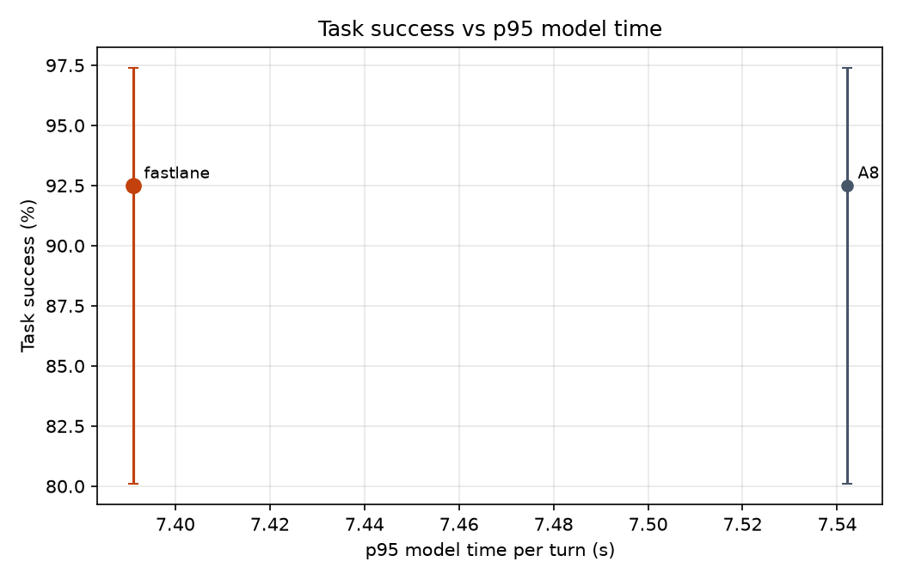

# Results: run `final_v5`

| System | Calls | Success (95% CI) | p50 model ms | p95 model ms | p95 vs B1 | Large-model turns | Router precision / hard recall | Hard recall, dates in code | Unsafe-write calls | Missed hand-offs |
|---|---|---|---|---|---|---|---|---|---|---|
| fastlane | 40 | 92.5% (80-97%) | 1,595 | 7,391 | - | 15.1% | 50.0% / 53.1% | 60.7% | 0.0% | 0/5 |
| A8 | 40 | 92.5% (80-97%) | 1,755 | 7,542 | - | 24.2% | 40.4% / 58.3% | 67.7% | 0.0% | 1/5 |

## fastlane

Fine-tuned small model answers easy turns and passes hard ones to the large model or staff.

- Success by category: {'change_mind': '3/5', 'dates': '5/5', 'policy': '4/5', 'red_flag': '5/5', 'returning': '5/5', 'rule_break': '5/5', 'simple': '5/5', 'sold_out': '5/5'}
- Success by domain: {'restaurants': '37/40'}
- Tokens per call (prompt, completion) by role: {'small': [3491, 267], 'large': [1800, 184]}
- Large-model calls per call: 0.9; rate-limit wait per call: 0.0 s
- Large-model calls answered by: {'groq:openai/gpt-oss-120b': 36}
- Unconfirmed writes: 0; rule-violating writes: 0
- Invalid tool-call rate: 0.017; success on calls with injected errors: 1.0
- Policy answer accuracy: 0.8; early lookup: {'started': 4, 'reused': 3, 'wasted': 0, 'cache_hits': 0, 'saved_ms_total': 2.8}
- Lookup-turn p95: 8413.8 ms; errors: 0
- Escalation reasons: {'tool error': 13, 'small model': 6, 'no availability': 6, 'staff': 5, 'caller changed time': 2, 'policy answer with numbers': 1, 'unconfident policy match': 1}

## A8

Adapter trained on movies and buses only; tested on restaurants.

- Success by category: {'change_mind': '4/5', 'dates': '5/5', 'policy': '4/5', 'red_flag': '4/5', 'returning': '5/5', 'rule_break': '5/5', 'simple': '5/5', 'sold_out': '5/5'}
- Success by domain: {'restaurants': '37/40'}
- Tokens per call (prompt, completion) by role: {'small': [4015, 297], 'large': [3691, 390]}
- Large-model calls per call: 1.82; rate-limit wait per call: 0.0 s
- Large-model calls answered by: {'groq:openai/gpt-oss-120b': 73}
- Unconfirmed writes: 0; rule-violating writes: 0
- Invalid tool-call rate: 0.026; success on calls with injected errors: 1.0
- Policy answer accuracy: 0.8; early lookup: {'started': 7, 'reused': 5, 'wasted': 0, 'cache_hits': 0, 'saved_ms_total': 4.2}
- Lookup-turn p95: 9148.0 ms; errors: 0
- Escalation reasons: {'small model': 19, 'tool error': 18, 'small model gave no reply': 6, 'no availability': 3, 'caller changed time': 2, 'small model repeated a tool call': 2, 'staff': 1, 'unconfident policy match': 1}
