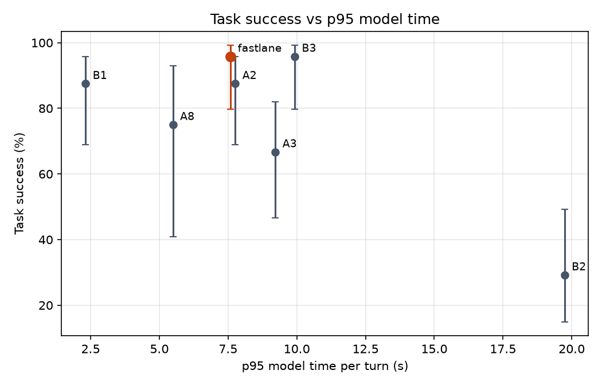

# Results: run `mid`

| System | Calls | Success (95% CI) | p50 model ms | p95 model ms | p95 vs B1 | Large-model turns | Router precision / hard recall | Hard recall, dates in code | Unsafe-write calls | Missed hand-offs |
|---|---|---|---|---|---|---|---|---|---|---|
| fastlane | 24 | 95.8% (80-99%) | 1,549 | 7,590 | -227.9% | 21.3% | 65.4% / 77.3% | 94.4% | 0.0% | 0/3 |
| B1 | 24 | 87.5% (69-96%) | 1,173 | 2,315 | 0.0% | 100.0% | - | - | 25.0% | 0/3 |
| B2 | 24 | 29.2% (15-49%) | 2,125 | 19,740 | -752.7% | 0.0% | - | - | 0.0% | 0/3 |
| B3 | 24 | 95.8% (80-99%) | 2,141 | 9,923 | -328.6% | 72.6% | 47.5% / 82.6% | 83.3% | 0.0% | 0/3 |
| A2 | 24 | 87.5% (69-96%) | 2,941 | 7,757 | -235.1% | 43.5% | 35.1% / 87.0% | - | 0.0% | 0/3 |
| A3 | 24 | 66.7% (47-82%) | 2,062 | 9,217 | -298.1% | 28.9% | 38.7% / 57.1% | 64.7% | 54.2% | 0/3 |
| A8 | 8 | 75.0% (41-93%) | 1,524 | 5,493 | -137.3% | 25.0% | 33.3% / 60.0% | 75.0% | 0.0% | 0/1 |

## fastlane

Fine-tuned small model answers easy turns and passes hard ones to the large model or staff.

- Success by category: {'change_mind': '3/3', 'dates': '3/3', 'policy': '2/3', 'red_flag': '3/3', 'returning': '3/3', 'rule_break': '3/3', 'simple': '3/3', 'sold_out': '3/3'}
- Success by domain: {'buses': '8/8', 'movies': '8/8', 'restaurants': '7/8'}
- Tokens per call (prompt, completion) by role: {'small': [3744, 274], 'large': [4156, 276]}
- Large-model calls per call: 1.67; rate-limit wait per call: 1.4 s
- Large-model calls answered by: {'gemini:gemini-3.5-flash': 8, 'groq:openai/gpt-oss-120b': 32}
- Unconfirmed writes: 0; rule-violating writes: 0
- Invalid tool-call rate: 0.008; success on calls with injected errors: 1.0
- Policy answer accuracy: 1.0; early lookup: {'started': 9, 'reused': 2, 'wasted': 3, 'cache_hits': 4, 'saved_ms_total': 0.9}
- Lookup-turn p95: 11129.4 ms; errors: 0
- Escalation reasons: {'tool error': 6, 'no availability': 4, 'small model gave no reply': 3, 'staff': 3, 'small model': 3, 'too many small-model steps': 2, 'policy answer with numbers': 2, 'caller changed time': 2}

## B1

Large model only; rules in the prompt.

- Success by category: {'change_mind': '1/3', 'dates': '2/3', 'policy': '3/3', 'red_flag': '3/3', 'returning': '3/3', 'rule_break': '3/3', 'simple': '3/3', 'sold_out': '3/3'}
- Success by domain: {'buses': '6/8', 'movies': '7/8', 'restaurants': '8/8'}
- Tokens per call (prompt, completion) by role: {'large': [18756, 1359]}
- Large-model calls per call: 8.21; rate-limit wait per call: 1146.4 s
- Large-model calls answered by: {'groq:openai/gpt-oss-120b': 197}
- Unconfirmed writes: 6; rule-violating writes: 0
- Invalid tool-call rate: 0.008; success on calls with injected errors: 1.0
- Policy answer accuracy: 1.0; early lookup: {'started': 8, 'reused': 3, 'wasted': 3, 'cache_hits': 0, 'saved_ms_total': 2.8}
- Lookup-turn p95: 1920.3 ms; errors: 0

## B2

Small model only, no fine-tuning; large model never used.

- Success by category: {'change_mind': '0/3', 'dates': '0/3', 'policy': '0/3', 'red_flag': '3/3', 'returning': '1/3', 'rule_break': '3/3', 'simple': '0/3', 'sold_out': '0/3'}
- Success by domain: {'buses': '2/8', 'movies': '3/8', 'restaurants': '2/8'}
- Tokens per call (prompt, completion) by role: {'small': [34536, 1789]}
- Large-model calls per call: 0.0; rate-limit wait per call: 0.0 s
- Large-model calls answered by: {}
- Unconfirmed writes: 0; rule-violating writes: 0
- Invalid tool-call rate: 0.261; success on calls with injected errors: 0.0
- Policy answer accuracy: 0.0; early lookup: {'started': 59, 'reused': 10, 'wasted': 21, 'cache_hits': 0, 'saved_ms_total': 10.5}
- Lookup-turn p95: 11674.7 ms; errors: 0

## B3

Large model prompted to route each turn easy/hard before it is answered.

- Success by category: {'change_mind': '3/3', 'dates': '3/3', 'policy': '3/3', 'red_flag': '3/3', 'returning': '3/3', 'rule_break': '3/3', 'simple': '3/3', 'sold_out': '2/3'}
- Success by domain: {'buses': '7/8', 'movies': '8/8', 'restaurants': '8/8'}
- Tokens per call (prompt, completion) by role: {'router': [871, 102], 'small': [2403, 201], 'large': [6221, 451]}
- Large-model calls per call: 6.25; rate-limit wait per call: 2644.0 s
- Large-model calls answered by: {'gemini:gemini-3.5-flash': 15, 'groq:openai/gpt-oss-120b': 135}
- Unconfirmed writes: 0; rule-violating writes: 0
- Invalid tool-call rate: 0.009; success on calls with injected errors: 1.0
- Policy answer accuracy: 1.0; early lookup: {'started': 7, 'reused': 1, 'wasted': 3, 'cache_hits': 0, 'saved_ms_total': 0.2}
- Lookup-turn p95: 17269.5 ms; errors: 0
- Escalation reasons: {'large-model router': 26, 'tool error': 7, 'no availability': 4, 'caller changed time': 2, 'caller changed seat_category': 1}

## A2

No date and alternative tools.

- Success by category: {'change_mind': '2/3', 'dates': '3/3', 'policy': '2/3', 'red_flag': '3/3', 'returning': '3/3', 'rule_break': '3/3', 'simple': '2/3', 'sold_out': '3/3'}
- Success by domain: {'buses': '7/8', 'movies': '6/8', 'restaurants': '8/8'}
- Tokens per call (prompt, completion) by role: {'small': [3982, 341], 'large': [6269, 798]}
- Large-model calls per call: 3.58; rate-limit wait per call: 397.4 s
- Large-model calls answered by: {'groq:openai/gpt-oss-120b': 86}
- Unconfirmed writes: 0; rule-violating writes: 0
- Invalid tool-call rate: 0.028; success on calls with injected errors: 1.0
- Policy answer accuracy: 0.667; early lookup: {'started': 10, 'reused': 3, 'wasted': 3, 'cache_hits': 1, 'saved_ms_total': 1.7}
- Lookup-turn p95: 6870.1 ms; errors: 0
- Escalation reasons: {'small model': 17, 'tool error': 15, 'small model gave no reply': 12, 'no availability': 3, 'staff': 3, 'policy answer with numbers': 3, 'caller changed time': 2, 'caller changed seat_category': 1}

## A3

No safety checks; rules only in the prompt, no read-back.

- Success by category: {'change_mind': '1/3', 'dates': '2/3', 'policy': '2/3', 'red_flag': '3/3', 'returning': '3/3', 'rule_break': '0/3', 'simple': '2/3', 'sold_out': '3/3'}
- Success by domain: {'buses': '4/8', 'movies': '7/8', 'restaurants': '5/8'}
- Tokens per call (prompt, completion) by role: {'small': [3730, 270], 'large': [6166, 262]}
- Large-model calls per call: 2.08; rate-limit wait per call: 1212.2 s
- Large-model calls answered by: {'gemini:gemini-3.5-flash': 21, 'groq:openai/gpt-oss-120b': 29}
- Unconfirmed writes: 17; rule-violating writes: 5
- Invalid tool-call rate: 0.058; success on calls with injected errors: 0.0
- Policy answer accuracy: 1.0; early lookup: {'started': 12, 'reused': 4, 'wasted': 3, 'cache_hits': 3, 'saved_ms_total': 2.4}
- Lookup-turn p95: 9204.0 ms; errors: 0
- Escalation reasons: {'tool error': 9, 'small model gave no reply': 8, 'policy answer with numbers': 3, 'staff': 3, 'no availability': 2, 'small model': 2, 'caller changed quantity': 1, 'caller changed seat_category': 1}

## A8

Adapter trained on movies and buses only; tested on restaurants.

- Success by category: {'change_mind': '0/1', 'dates': '1/1', 'policy': '0/1', 'red_flag': '1/1', 'returning': '1/1', 'rule_break': '1/1', 'simple': '1/1', 'sold_out': '1/1'}
- Success by domain: {'restaurants': '6/8'}
- Tokens per call (prompt, completion) by role: {'small': [2457, 189], 'large': [3145, 227]}
- Large-model calls per call: 1.62; rate-limit wait per call: 1238.2 s
- Large-model calls answered by: {'groq:openai/gpt-oss-120b': 13}
- Unconfirmed writes: 0; rule-violating writes: 0
- Invalid tool-call rate: 0.121; success on calls with injected errors: None
- Policy answer accuracy: 1.0; early lookup: {'started': 0, 'reused': 0, 'wasted': 0, 'cache_hits': 0, 'saved_ms_total': 0.0}
- Lookup-turn p95: 6578.1 ms; errors: 0
- Escalation reasons: {'tool error': 5, 'caller changed time': 1, 'policy answer with numbers': 1, 'small model': 1, 'staff': 1}
