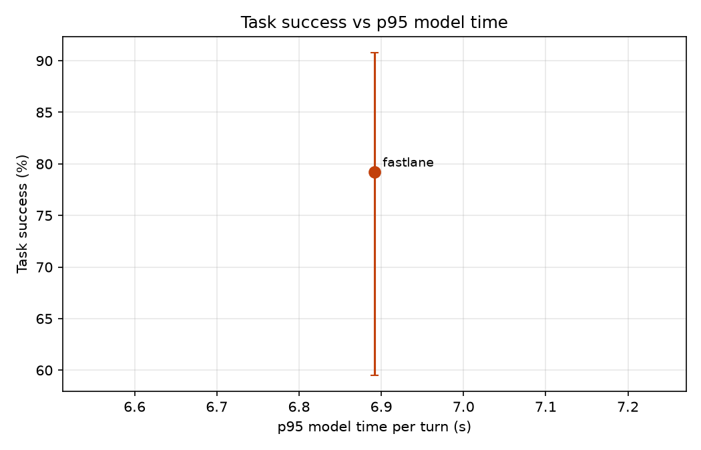

# Results: run `pilot`

| System | Calls | Success (95% CI) | p50 model ms | p95 model ms | p95 vs B1 | Large-model turns | Router precision / hard recall | Unsafe-write calls | Missed hand-offs |
|---|---|---|---|---|---|---|---|---|---|
| fastlane | 24 | 79.2% (60-91%) | 2,882 | 6,892 | - | 60.7% | 25.3% / 90.5% | 0.0% | 0/3 |

## fastlane

Fine-tuned small model answers easy turns and passes hard ones to the large model or staff.

- Success by category: {'change_mind': '2/3', 'dates': '3/3', 'policy': '0/3', 'red_flag': '3/3', 'returning': '3/3', 'rule_break': '3/3', 'simple': '3/3', 'sold_out': '2/3'}
- Success by domain: {'buses': '6/8', 'movies': '7/8', 'restaurants': '6/8'}
- Tokens per call (prompt, completion) by role: {'small': [4694, 204], 'large': [12013, 1051]}
- Large-model calls per call: 6.12; rate-limit wait per call: 110.3 s
- Large-model calls answered by: {'groq:openai/gpt-oss-120b': 147}
- Unconfirmed writes: 0; rule-violating writes: 0
- Invalid tool-call rate: 0.076; success on calls with injected errors: 1.0
- Policy answer accuracy: 0.667; early lookup: {'started': 7, 'reused': 3, 'wasted': 1, 'cache_hits': 0, 'saved_ms_total': 2.3}
- Lookup-turn p95: 5532.5 ms; errors: 0
- Escalation reasons: {'small model': 57, 'tool error': 9, 'staff': 7, 'no availability': 2}
