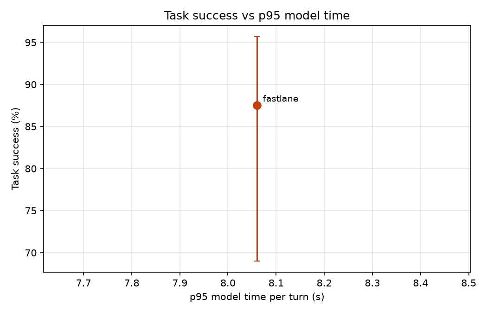

# Results: run `pilot_v3`

| System | Calls | Success (95% CI) | p50 model ms | p95 model ms | p95 vs B1 | Large-model turns | Router precision / hard recall | Unsafe-write calls | Missed hand-offs |
|---|---|---|---|---|---|---|---|---|---|
| fastlane | 24 | 87.5% (69-96%) | 1,664 | 8,060 | - | 13.5% | 76.5% / 56.5% | 0.0% | 0/3 |

## fastlane

Fine-tuned small model answers easy turns and passes hard ones to the large model or staff.

- Success by category: {'change_mind': '3/3', 'dates': '2/3', 'policy': '2/3', 'red_flag': '3/3', 'returning': '3/3', 'rule_break': '2/3', 'simple': '3/3', 'sold_out': '3/3'}
- Success by domain: {'buses': '5/8', 'movies': '8/8', 'restaurants': '8/8'}
- Tokens per call (prompt, completion) by role: {'small': [3592, 266], 'large': [2316, 200]}
- Large-model calls per call: 1.04; rate-limit wait per call: 0.0 s
- Large-model calls answered by: {'gemini:gemini-3.5-flash': 3, 'groq:openai/gpt-oss-120b': 22}
- Unconfirmed writes: 0; rule-violating writes: 0
- Invalid tool-call rate: 0.009; success on calls with injected errors: 1.0
- Policy answer accuracy: 0.667; early lookup: {'started': 11, 'reused': 3, 'wasted': 4, 'cache_hits': 4, 'saved_ms_total': 1.8}
- Lookup-turn p95: 9817.2 ms; errors: 0
- Escalation reasons: {'no availability': 3, 'small model gave no reply': 3, 'tool error': 3, 'staff': 3, 'small model': 2, 'caller changed seat_category': 1, 'too many small-model steps': 1, 'caller changed time': 1}
